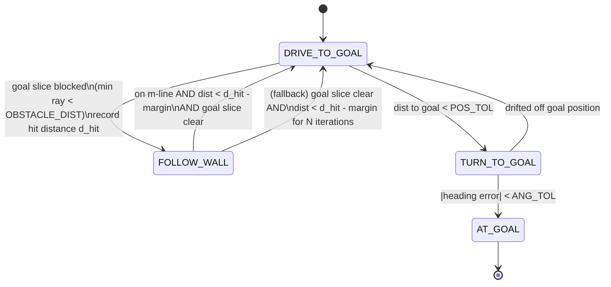

# P2.2 Algorithm Design: Bug Navigation

This document describes the autonomous navigation algorithm implemented in
[`bug_navigation.py`](bug_navigation.py). It is a **Bug 2** algorithm adapted to
the omnidirectional MBot-Omni: the robot drives straight for the goal along the
*m-line* (the line from the start pose to the goal), follows the boundary of any
obstacle that blocks it, and leaves the boundary when it is back on the m-line
closer to the goal than where it hit the obstacle.

## Inputs and sensing

| Signal | Source | Use |
|---|---|---|
| Pose `(x, y, θ)` | `robot.read_odometry()` | Position error to the goal, m-line distance |
| Lidar `(ranges, thetas)` | `robot.read_lidar()` | Obstacle detection, wall following |
| Goal `(gx, gy, gθ)` | User input / command line | Target pose in the odometry frame |

**Obstacle detection** uses `find_min_ray_in_slice(ranges, thetas, target_angle, slice_size)`
(in [`utils.py`](utils.py)). It returns the index of the shortest valid ray whose
angle is within `slice_size / 2` of `target_angle`. The slice is centred on the
direction to the goal (in the robot frame), so an obstacle near, but not exactly
on, the goal ray is still caught. The goal direction counts as **blocked** when
the shortest ray in the slice is shorter than `OBSTACLE_DIST` (0.45 m) *and*
shorter than the distance to the goal (otherwise the "obstacle" is behind the goal).

Because the MBot-Omni can translate in any direction, the robot keeps its heading
fixed while navigating and only rotates once it reaches the goal position. This
keeps the Lidar frame and the velocity frame aligned and simplifies the controller.

## States

The state is tracked as an integer and printed every iteration (P2.3).

| # | State | What the robot does |
|---|---|---|
| 0 | `DRIVE_TO_GOAL` | Proportional control straight toward the goal position |
| 1 | `FOLLOW_WALL` | Follow the obstacle boundary at a fixed stand-off distance |
| 2 | `TURN_TO_GOAL` | Rotate in place to the goal heading |
| 3 | `AT_GOAL` | Stop; print final pose; exit |

## State machine



```
                 blocked                        back on m-line & closer & clear
 +---------------+ ----------> +-------------+ -------------------------------+
 | DRIVE_TO_GOAL |             | FOLLOW_WALL |                                |
 +---------------+ <---------- +-------------+ <------------------------------+
        |
        | dist < POS_TOL
        v
 +---------------+  |heading err| < ANG_TOL  +----------+
 | TURN_TO_GOAL  | --------------------------> | AT_GOAL |
 +---------------+                             +----------+
```

## Pseudocode

```
INPUT  goal = (gx, gy, gθ)
state ← DRIVE_TO_GOAL
start ← first odometry reading          # defines the m-line start → goal

LOOP every 50 ms until state == AT_GOAL:
    pose ← read_odometry()               # (x, y, θ)
    ranges, thetas ← read_lidar()

    dist        ← ‖goal − pose‖
    goal_angle  ← wrap(atan2(gy − y, gx − x) − θ)        # goal direction, robot frame
    i           ← find_min_ray_in_slice(ranges, thetas, goal_angle, GOAL_SLICE)
    min_dist    ← ranges[i]  (∞ if no valid ray)

    IF state == DRIVE_TO_GOAL:
        IF dist < POS_TOL:                 state ← TURN_TO_GOAL
        ELSE IF min_dist < OBSTACLE_DIST AND min_dist < dist:
            d_hit ← dist                   # remember where we hit the obstacle
            side  ← (obstacle ray is right of goal direction) ? wall-on-right : wall-on-left
            state ← FOLLOW_WALL
        ELSE:
            speed ← clamp(Kp · dist, MIN_SPEED, MAX_SPEED)    # slow down near obstacles
            drive(speed·cos(goal_angle), speed·sin(goal_angle), 0)

    ELSE IF state == FOLLOW_WALL:
        wall_dist, wall_angle ← shortest valid ray in the whole scan
        on_mline   ← perpendicular distance from pose to m-line < MLINE_TOL
        closer     ← dist < d_hit − LEAVE_MARGIN
        goal_clear ← min_dist > min(CLEAR_DIST, dist)
        IF closer AND goal_clear AND on_mline (after having left it):   state ← DRIVE_TO_GOAL
        ELSE IF closer AND goal_clear for N consecutive iterations:     state ← DRIVE_TO_GOAL
        ELSE:
            tangent ← wall_angle ± π/2                 # travel along the wall, wall on chosen side
            radial  ← clamp(Kw · (wall_dist − SETPOINT))   # hold stand-off distance (P1 wall follower)
            IF something ahead along tangent: reduce tangential speed
            drive(v·cos(tangent) + radial·cos(wall_angle),
                  v·sin(tangent) + radial·sin(wall_angle), 0)

    ELSE IF state == TURN_TO_GOAL:
        err ← wrap(gθ − θ)
        IF |err| < ANG_TOL:   state ← AT_GOAL
        ELSE IF dist > 2·POS_TOL: state ← DRIVE_TO_GOAL
        ELSE drive(0, 0, clamp(Kθ · err))

    PRINT iteration, state, pose, dist, min_dist, command     # P2.3
    sleep(50 ms)

stop()
PRINT final odometry
```

## Design notes

* **Why Bug 2.** Bug 2 leaves the obstacle as soon as the m-line is re-crossed
  closer to the goal, so it takes shorter paths than Bug 1 on the convex boxes
  used in the demo course. A fallback "leave" rule (clear line of sight to the
  goal and closer than the hit point for several consecutive iterations) keeps
  the robot from circling an obstacle forever if odometry drift makes it miss
  the m-line by more than the tolerance.
* **Side selection.** When the goal direction is blocked, the robot looks at
  which side of the goal ray the closest obstacle ray is on and goes around the
  other way, so it does not take the long way around off-centre boxes.
* **Wall following** is the Project 1 controller: the shortest ray in the scan
  is the wall, the robot translates perpendicular to it and applies proportional
  control on the stand-off distance. Slowing down when a surface appears in the
  direction of travel lets the "nearest ray" switch smoothly at inside corners.
* **Safety.** Speeds are clamped, tiny commands are raised to the motors'
  minimum, a timeout stops the run, and `robot.stop()` is always sent on exit.
* **Testing.** `sim/run_sim.py` runs both scripts against a small 2D simulator
  with ray-cast Lidar (see the README) so the state machine can be exercised
  without the robot.
