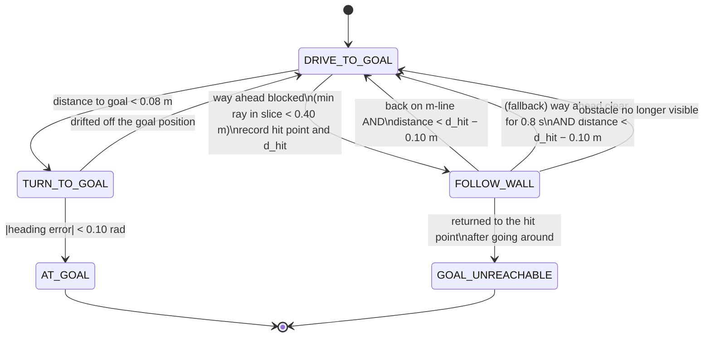

# P2.2 Algorithm Design: Bug Navigation

This document describes the autonomous navigation algorithm implemented in
[`bug_navigation.py`](bug_navigation.py). It is a **Bug 2** algorithm adapted to
the omnidirectional MBot-Omni:

1. Drive toward the goal along the *m-line*, the straight line from the start
   pose to the goal.
2. When an obstacle blocks the way, follow its boundary.
3. Leave the boundary once the robot is back on the m-line, closer to the goal
   than where it hit the obstacle, then continue along the m-line.
4. If the robot goes all the way around the obstacle without finding a way
   through, the goal is unreachable, so stop.

The robot only knows its odometry pose, its current Lidar scan and the goal. It
has no map.

## Inputs and sensing

| Signal | Source | Use |
|---|---|---|
| Pose `(x, y, θ)` | `robot.read_odometry()` | Position relative to the m-line and the goal |
| Lidar `(ranges, thetas)` | `robot.read_lidar()` | Obstacle detection, wall following, safety |
| Goal `(gx, gy, gθ)` | User input or command line | Target pose in the odometry frame |

**Obstacle detection** uses `find_min_ray_in_slice(ranges, thetas, target_angle, slice_size)`
from [`utils.py`](utils.py). It returns the index of the shortest valid ray
whose angle is within `slice_size / 2` of `target_angle`. The slice is 70° wide
and centred on the direction the robot is about to drive, so an obstacle near,
but not exactly on, that direction is still caught. The way is **blocked** when
the shortest ray in the slice is under `OBSTACLE_DIST` (0.40 m) *and* shorter
than the distance to the goal. Otherwise the object is behind the goal.

Because the MBot-Omni can translate in any direction, the robot holds its
starting heading while it travels and only rotates once it reaches the goal
position. This keeps the Lidar frame and the velocity frame aligned.

## States

The state is tracked as an integer and printed every iteration (P2.3).

| # | State | What the robot does |
|---|---|---|
| 0 | `DRIVE_TO_GOAL` | Travel along the m-line toward the goal |
| 1 | `FOLLOW_WALL` | Follow the obstacle's boundary at a fixed distance |
| 2 | `TURN_TO_GOAL` | Rotate in place to the goal heading |
| 3 | `AT_GOAL` | Stop, print the final pose, exit |
| 4 | `GOAL_UNREACHABLE` | Went all the way around the obstacle with no way through; stop and exit |

## State machine



```
                     blocked                       back on m-line & closer
 +---------------+ ------------> +-------------+ -------------------------+
 | DRIVE_TO_GOAL |               | FOLLOW_WALL |                          |
 +---------------+ <------------ +-------------+ <------------------------+
        |                               |
        | at goal position              | back at the hit point after
        v                               v going all the way around
 +---------------+                +------------------+
 | TURN_TO_GOAL  |                | GOAL_UNREACHABLE |
 +---------------+                +------------------+
        |
        | heading correct
        v
 +---------------+
 |    AT_GOAL    |
 +---------------+
```

## Pseudocode

```
INPUT  goal = (gx, gy, gθ)
state ← DRIVE_TO_GOAL
start ← first odometry reading           # the m-line runs from start to goal
hold_θ ← starting heading                # heading kept while translating

LOOP every 50 ms until state is AT_GOAL or GOAL_UNREACHABLE:
    pose ← read_odometry()
    ranges, thetas ← read_lidar()
    dist ← ‖goal − pose‖

    # Direction to travel: aim at the point 0.10 m further along the m-line.
    # On the line this points at the goal. Off the line it points back onto it.
    travel ← mline_heading(pose)
    i ← find_min_ray_in_slice(ranges, thetas, travel, 70°)
    ahead ← ranges[i]   (∞ if no valid ray)

    IF state == DRIVE_TO_GOAL:
        IF dist < POS_TOL:  state ← TURN_TO_GOAL; hold_θ ← gθ
        ELSE IF ahead < 0.40 AND ahead < dist:
            d_hit ← dist; hit_point ← pose
            IF we did not just leave another obstacle:
                side ← go around on the side away from the nearest ray
            state ← FOLLOW_WALL
        ELSE:
            command ← speed toward travel, speed = clamp(Kp · dist, 0.25, 0.35)

    ELSE IF state == FOLLOW_WALL:
        closer ← dist < d_hit − 0.10
        IF closer AND on m-line (within 0.12 m) AND has left the m-line since the hit:
            state ← DRIVE_TO_GOAL
        ELSE IF closer AND ahead > 0.60 for 0.8 s:
            state ← DRIVE_TO_GOAL
        ELSE IF went more than 0.5 m from hit_point and came back within 0.2 m:
            state ← GOAL_UNREACHABLE
        ELSE:
            IF not moving for 4 s: side ← −side       # try the other way round
            wall ← closest point on the SAME obstacle as last iteration
            IF no wall within 1 m: state ← DRIVE_TO_GOAL
            ELSE:
                tangent ← wall_angle + side · 90°
                radial  ← clamp(Kw · (wall_dist − 0.27))   # Project 1 wall follower
                command ← 0.30 · tangent + radial toward the wall

    ELSE IF state == TURN_TO_GOAL:
        err ← wrap(gθ − θ)
        IF |err| < ANG_TOL:        state ← AT_GOAL
        ELSE IF dist > 2·POS_TOL:  state ← DRIVE_TO_GOAL
        ELSE command ← rotate at max(Kθ · |err|, 0.6 rad/s) toward gθ

    command ← shape_command(command)    # see below
    PRINT iteration, time, state, pose, dist, ahead, command    # P2.3
    drive(command); sleep(50 ms)

stop(); PRINT final odometry
```

`shape_command` applies the same safeguards in every state:

```
IF translating:
    IF anything is closer than 0.17 m:     # safety bubble
        remove the part of the command heading into it and add a push away
    speed ← clamp(speed, 0.25, 0.35) × stall_boost, capped at 0.55 m/s
    wz ← Kh · (hold_θ − θ)                 # heading hold
IF rotating in place:
    wz ← wz × turn_boost, capped at 3 rad/s

stall_boost: every 0.4 s, if the robot was told to move but odometry shows it
moved less than 4 cm/s, multiply the boost by 1.25, up to 2.5×.
```

### Finding "the wall" in a cluttered room

Taking the closest ray in the whole scan as the wall does not work when several
objects are nearby. As soon as a different object becomes closer, the wall jumps
to it, the direction of travel reverses, and the robot shuttles between the two.

Instead, Lidar points closer together than 0.45 m are linked into one obstacle,
since the robot cannot fit between them anyway. Each iteration starts from the
point nearest to where the wall was last time, collects every point linked to
it, and uses the closest of those as the wall. Objects separated by a passable
gap are ignored until the robot reaches them.

## Design notes

* **Why Bug 2.** Bug 2 leaves an obstacle as soon as it re-crosses the m-line
  closer to the goal, so it takes much shorter paths than Bug 1 on the boxes
  used in the demo course. Bug 1 circles every obstacle completely first.
* **Rejoining the m-line.** The robot drives along the m-line rather than
  straight at the goal. After it leaves an obstacle by the fallback rule, it is
  pulled back onto the original line within about 0.1 m and continues along it.
  An earlier version aimed straight at the goal from wherever it left the
  obstacle, which made a Y-shaped diagonal path.
* **Lessons from the real robot.** The first version worked in simulation but
  barely moved on the MBot. Its wheels do not turn at all for commands below
  about 0.25 m/s, and the controller slowed to exactly those speeds near
  obstacles and near the goal. The robot now never commands a crawl: it either
  moves at 0.25 to 0.35 m/s or stops. If odometry shows it still is not moving,
  the stall boost raises the command until it does. The boost is kept for the
  rest of the run, since the stall speed belongs to the robot, not the moment.
* **Giving up.** If the robot returns to its hit point after going around, no
  path along this obstacle leads to the goal, for example when the goal is
  outside the room. It stops in `GOAL_UNREACHABLE` instead of circling forever.
* **Side selection.** The robot goes around on the side away from the nearest
  obstacle ray. If it hits a second obstacle within 1.5 s of leaving the first,
  it keeps going the same way round so it cannot bounce between two obstacles.
* **Safety.** Speeds are capped, a safety bubble backs away from anything
  within 0.17 m, a 180 s timeout stops the run, and `robot.stop()` is always sent
  on exit, including on Ctrl+C.

## Testing

[`sim/run_sim.py`](sim/run_sim.py) runs the real navigation code against a 2D
simulator with ray-cast Lidar, with two robot models:

* **Ideal:** perfect motors and Lidar.
* **Realistic:** modelled on logs from our MBot. The wheels do not turn below a
  minimum speed and under-deliver above it, the Lidar is noisy and updates at
  about 8 Hz, and every bridge call has a delay.

| Test | Result |
|---|---|
| Hit the spot, 4 goals, both robot models | 8 / 8 within 8 cm and 0.10 rad |
| Bug navigation, 11 scenarios, both robot models | 22 / 22, no collisions |
| Robustness sweep, 12 robot variations × 11 scenarios | 111 / 132 |

The scenarios are an open floor, a box, a long wall, two staggered boxes, a
corridor, a U-shaped trap, a small room with a box, a room split by a 0.55 m
doorway, a cluttered room, and two goals that cannot be reached. Every failure
in the sweep was in the narrow doorway or the cluttered room under the noisiest
Lidar setting, where the robot wrongly gave up. Single obstacles, walls and the
U-trap passed in every variation.
